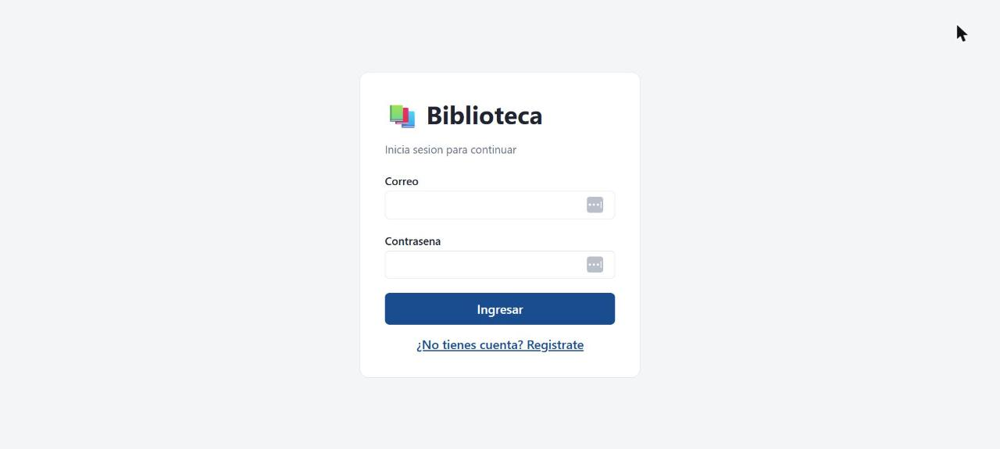
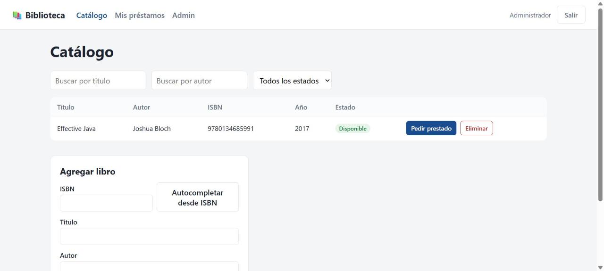
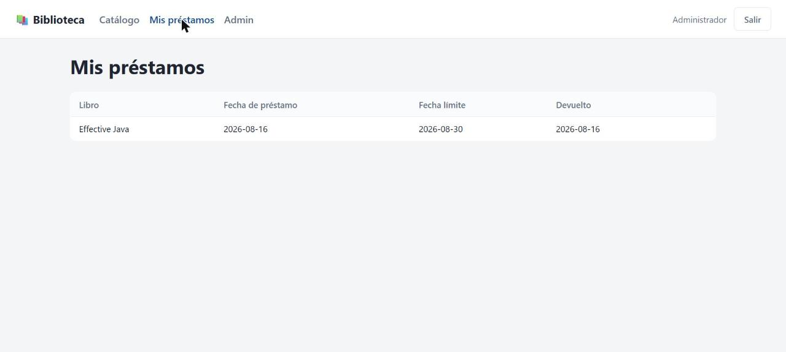
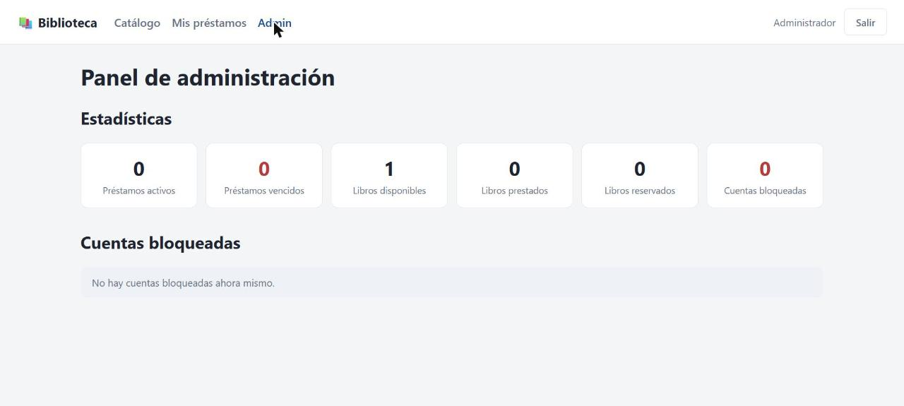

# Biblioteca

Sistema de gestion de prestamos para biblioteca. Backend en Spring Boot (Java 21) con PostgreSQL, autenticacion JWT, notificaciones por correo, integracion con Open Library y un frontend en React + TypeScript.

## Capturas

| Login | Catalogo |
|---|---|
|  |  |

| Mis prestamos | Panel de administracion |
|---|---|
|  |  |

## Stack

**Backend**
- Java 21, Spring Boot 3.3
- Spring Web, Spring Data JPA, Spring Security, Spring Mail, Spring Cache
- PostgreSQL + Flyway (migraciones)
- JWT (jjwt), Caffeine (cache), Thymeleaf (plantillas de correo)
- springdoc-openapi (Swagger UI)
- JUnit 5, Mockito, WireMock, GreenMail

**Frontend**
- React 18 + TypeScript, Vite
- React Router, Axios, Zustand

**Infraestructura**
- Docker Compose: PostgreSQL, MailHog (SMTP de pruebas), backend, frontend (nginx)

## Estructura del repositorio

```
backend/     API REST (Spring Boot)
frontend/    SPA (React + Vite)
postman/     Coleccion de Postman para probar la API
docker-compose.yml
.env.example
```

## Requisitos previos

- Docker y Docker Compose
- Para desarrollo local sin Docker: JDK 21, Node.js 20+, PostgreSQL 16

## Puesta en marcha con Docker

```bash
cp .env.example .env
docker compose up --build
```

Servicios expuestos:

| Servicio          | URL                                      |
|--------------------|-------------------------------------------|
| Frontend            | http://localhost:5173                    |
| API                  | http://localhost:8080/api                |
| Swagger UI           | http://localhost:8080/swagger-ui.html    |
| MailHog (bandeja web)| http://localhost:8025                    |
| PostgreSQL            | localhost:5432                           |

Las migraciones de Flyway crean el esquema y siembran un usuario ADMIN de prueba:

- **Email:** `admin@biblioteca.local`
- **Password:** `Admin123!`

## Desarrollo local (sin Docker)

**Backend**

```bash
cd backend
./mvnw spring-boot:run
```

Requiere una instancia de PostgreSQL accesible con las credenciales de `.env` (o las que defina `application.yml`, perfil `local`). Para el envio de correos en local, MailHog se puede levantar suelto:

```bash
docker run -p 1025:1025 -p 8025:8025 mailhog/mailhog:v1.0.1
```

**Frontend**

```bash
cd frontend
npm install
npm run dev
```

El proxy de Vite (`vite.config.ts`) redirige `/api` hacia `http://localhost:8080`.

## Variables de entorno

Ver `.env.example`. Las mas relevantes:

| Variable                  | Descripcion                                  | Default                                          |
|----------------------------|-----------------------------------------------|----------------------------------------------------|
| `DB_NAME` / `DB_USER` / `DB_PASSWORD` | Credenciales de PostgreSQL         | `biblioteca` / `biblioteca` / `biblioteca`          |
| `DB_HOST` / `DB_PORT`      | Host y puerto de PostgreSQL                   | `localhost` / `5432`                                |
| `MAIL_HOST` / `MAIL_PORT`  | Servidor SMTP                                 | `localhost` / `1025`                                |
| `MAIL_FROM`                | Remitente de los correos                      | `biblioteca@biblioteca.local`                         |
| `JWT_SECRET`               | Secreto para firmar los tokens JWT            | *(cambiar en produccion)*                           |
| `JWT_EXPIRATION_MS`        | Vigencia del token en milisegundos            | `86400000` (24h)                                    |
| `OPENLIBRARY_BASE_URL`     | Base de la API de Open Library (ISBN lookup)  | `https://openlibrary.org`                           |
| `OPENLIBRARY_COVERS_URL`   | Base para portadas de libros                  | `https://covers.openlibrary.org`                    |

## Autenticacion y roles

La API usa JWT via header `Authorization: Bearer <token>`. Existen dos roles:

- **BIBLIOTECARIO**: rol por defecto al registrarse. Puede consultar el catalogo, pedir y devolver prestamos, y crear/cancelar reservas.
- **ADMIN**: ademas puede dar de alta/baja libros y acceder al panel de administracion (estadisticas y usuarios bloqueados). Las cuentas ADMIN no se auto-registran; se siembran manualmente (ver migracion `V5`).

Un usuario queda bloqueado automaticamente al acumular 3 devoluciones tardias en una ventana de 90 dias, y permanece bloqueado 7 dias (o hasta que un ADMIN lo desbloquee manualmente).

## Endpoints principales

| Metodo | Ruta                          | Acceso           | Descripcion                                   |
|--------|-------------------------------|-------------------|--------------------------------------------------|
| POST   | `/api/auth/register`          | Publico            | Crea una cuenta BIBLIOTECARIO                     |
| POST   | `/api/auth/login`             | Publico            | Autentica y devuelve un JWT                       |
| GET    | `/api/books`                  | Autenticado         | Busca/lista libros (filtros por titulo, autor, estado) |
| GET    | `/api/books/lookup/{isbn}`    | Autenticado         | Preview de datos externos desde Open Library      |
| POST   | `/api/books`                  | ADMIN               | Da de alta un libro                               |
| DELETE | `/api/books/{id}`             | ADMIN               | Elimina un libro                                  |
| POST   | `/api/loans`                  | Autenticado         | Registra un prestamo                              |
| GET    | `/api/loans/mine`             | Autenticado         | Lista los prestamos del usuario                   |
| PUT    | `/api/loans/{id}/return`      | Autenticado         | Marca un prestamo como devuelto                   |
| POST   | `/api/reservations`           | Autenticado         | Reserva un libro no disponible                    |
| DELETE | `/api/reservations/{id}`      | Autenticado         | Cancela una reserva                               |
| GET    | `/api/admin/stats`            | ADMIN               | Estadisticas globales (prestamos activos, vencidos, etc.) |
| GET    | `/api/admin/users/blocked`    | ADMIN               | Lista usuarios bloqueados                         |
| PUT    | `/api/admin/users/{id}/unblock`| ADMIN              | Levanta el bloqueo de un usuario                  |

Documentacion interactiva completa en Swagger UI (`/swagger-ui.html`) y coleccion lista para importar en `postman/Biblioteca.postman_collection.json`.

## Estados del dominio

- **Libro:** `DISPONIBLE` → `PRESTADO` → `DISPONIBLE` (o `RESERVADO` si hay alguien en la fila de espera)
- **Reserva:** `PENDIENTE` → `NOTIFICADO` → `CUMPLIDO` / `CANCELADO`

Al devolver un libro, si hay reservas pendientes se notifica por correo al primero de la fila (FIFO) y el libro pasa a `RESERVADO` en vez de `DISPONIBLE`.

## Notificaciones por correo

Se envian de forma asincrona (despues del commit de la transaccion) para:

- Confirmacion de prestamo
- Recordatorio de vencimiento proximo (job diario, `app.loan.reminder-days-before-due`)
- Aviso de prestamo vencido (job diario)
- Aviso de cuenta bloqueada
- Aviso de libro disponible (reserva cumplida)

En Docker/local, todos los correos se capturan en MailHog (http://localhost:8025) sin salir a internet.

## Tests

```bash
cd backend
./mvnw test
```

Incluye tests unitarios (Mockito), tests de integracion de correo con SMTP embebido (GreenMail) y tests del cliente de Open Library simulando la API externa con WireMock.
